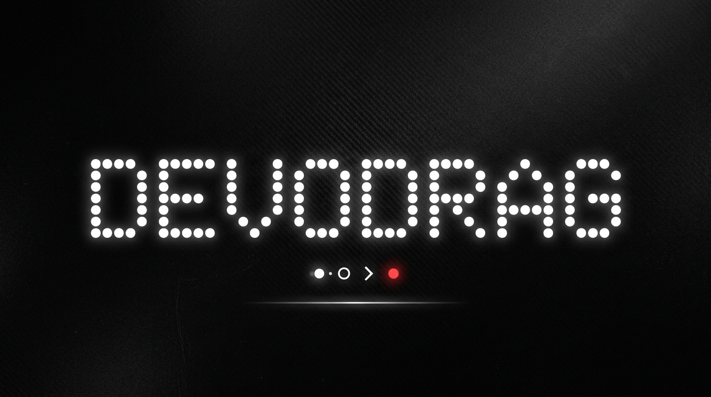

<div align="center">

  <!-- Nothing OS Style Dot-Matrix Banner -->
  

  <br/><br/>

  <!-- Dynamic Typing Subtitle (Console Style) -->
  <p align="center">
    
  </p>

  <!-- System Subheader -->
  <p align="center">
    <code><b>( • ) SYSTEM ONLINE &nbsp;|&nbsp; KERNEL 0x7F &nbsp;|&nbsp; BACKEND ARCHITECT</b></code>
  </p>

  <!-- Social Badges + Minimalist Views Counter -->
  <p align="center">
    <a href="https://t.me/tabyru"></a>&nbsp;
    <a href="https://x.com/devodrag"></a>&nbsp;
    <a href="https://discord.com"></a>&nbsp;
    <a href="https://github.com/devodrag"></a>
  </p>

  <br/>

  <!-- iOS / Nothing Widget Style Bento Bar -->
  <table width="100%" border="0" cellspacing="0" cellpadding="0">
    <tr>
      <td align="center" style="background:#0D0D0D; border:1px solid #222222; border-radius:12px; padding:12px;">
        <code><b>STATUS</b></code><br/>
        <span>🔴 Open to collaborate</span>
      </td>
      <td width="10"></td>
      <td align="center" style="background:#0D0D0D; border:1px solid #222222; border-radius:12px; padding:12px;">
        <code><b>CORE FOCUS</b></code><br/>
        <span>⚡ High-Load & Microservices</span>
      </td>
      <td width="10"></td>
      <td align="center" style="background:#0D0D0D; border:1px solid #222222; border-radius:12px; padding:12px;">
        <code><b>LOCATION</b></code><br/>
        <span>🌍 Remote / Earth</span>
      </td>
    </tr>
  </table>

</div>

<br/>

---

### <code>( 01 ) // OVERVIEW</code>

```yaml
identity:
  handle: devodrag
  role: Backend Software Engineer
  architecture: Distributed Systems, Low-Latency & Concurrency
  philosophy: "Simplicity is prerequisite for reliability"
  contacts:
    telegram: "@tabyru"
    x_twitter: "@devodrag"
    discord: "swift.dat"
```

---

### <code>( 02 ) // TECH STACK & TOOLING</code>

<p>
  <b>SYSTEMS & BACKEND CORE</b><br/>
  
  
  
  
  
</p>

<p>
  <b>FRONTEND & RUNTIMES</b><br/>
  
  
  
</p>

<p>
  <b>DEVOPS & DESIGN</b><br/>
  
  
  
</p>

---

### <code>( 03 ) // TELEMETRY & STATS</code>

<div align="center">
  <table border="0" cellspacing="0" cellpadding="0">
    <tr valign="top">
      <td>
        
      </td>
      <td width="15"></td>
      <td>
        
      </td>
    </tr>
  </table>

  <br/>

  
</div>

<br/>

---

### <code>( 04 ) // ACTIVITY GLYPH // SNAKE</code>

<div align="center">
  
</div>

<br/>

---

### <code>( 05 ) // SYSTEM LOGS</code>

```diff
+ [2026] Distributed systems & high-throughput backend services
+ [2025] High-concurrency engines & memory optimization in C++ / Go
+ [2024] Microservices architecture & API design in C# .NET / Python
! Priority: Low Latency, Scalability, Clean Architecture
```

